# Gestor de Torneos y Equipos

Trabajo práctico integrador de **Arquitectura y Desarrollo de Software** (Ingeniería en Sistemas Informáticos, UAI, 2026), **Grupo 1**.

Aplicación de escritorio en C# (.NET 10, Windows Forms) para administrar países, equipos, jugadores, torneos y partidos de fútbol, con una arquitectura en capas y persistencia en SQL Server mediante Entity Framework Core.

| | |
|---|---|
| **Universidad** | Universidad Abierta Interamericana (UAI) |
| **Carrera** | Ingeniería en Sistemas Informáticos |
| **Materia** | Arquitectura y Desarrollo de Software |
| **Docente** | Gonzalo Facundo Arigos |
| **Año** | 2026 |
| **Entrega y defensa** | 27/11/2026 |

**Integrantes:** Gianluca Gallino · Alan García López · Matheo Albarracín · Santiago Eliceche · Valentín Fernández · Franco Bernal · Gonzalo Baldi

---

## Contenido

1. [Guía de configuración](#1-guía-de-configuración)
2. [Guía de uso y casos de uso](#2-guía-de-uso-y-casos-de-uso)
3. [Restricciones y reglas de negocio](#3-restricciones-y-reglas-de-negocio)
4. [Descripción técnica](#4-descripción-técnica)
5. [Modelo de datos](#5-modelo-de-datos)
6. [Diagrama de clases](#6-diagrama-de-clases)

---

## 1. Guía de configuración

### Requisitos

| Componente | Versión |
|---|---|
| Sistema operativo | Windows 10 u 11 |
| IDE | Visual Studio 2026, con la carga de trabajo **Desarrollo de escritorio de .NET** |
| SDK | .NET 10 |
| Base de datos | Microsoft SQL Server (Express alcanza) y SQL Server Management Studio (SSMS) |

### Paso 1 — Obtener el código

- Con **GitHub Desktop**: `File → Clone repository → URL` y pegar `https://github.com/gianlucaegallino/TP-2026-GRUPO1-ADS`.
- O descargar el ZIP desde GitHub (`Code → Download ZIP`) y descomprimirlo.

### Paso 2 — Crear la base de datos

1. Abrir SSMS y conectarse al servidor de SQL Server.
2. Abrir el archivo `Database/GestorTorneosEquiposDB.sql` (`File → Open → File`).
3. Ejecutarlo con **Execute** (F5).

El script crea la base **`GestorTorneosEquipos`** con sus 5 tablas, las claves foráneas y datos de prueba.

### Paso 3 — Configurar la cadena de conexión

Abrir `TrabajoPracticoGrupoUno/UI/App.config` y ajustar `Data Source` (nombre del servidor) e `Initial Catalog` (nombre de la base):

```xml
<connectionStrings>
  <add name="GrupoUnoFutbolConnection"
       connectionString="Data Source=localhost\SQLEXPRESS;Initial Catalog=GestorTorneosEquipos;Integrated Security=True;Trust Server Certificate=True"
       providerName="Microsoft.Data.SqlClient" />
</connectionStrings>
```

> El nombre del servidor es el que aparece en SSMS al conectarse (por ejemplo `localhost`, `.\SQLEXPRESS` o `NOMBRE-PC\SQLEXPRESS`). No cambiar el atributo `name`: el código busca `GrupoUnoFutbolConnection`.

### Paso 4 — Abrir y ejecutar

1. Abrir la solución `TrabajoPracticoGrupoUno/TrabajoPracticoFutbol.slnx` en Visual Studio.
2. Esperar a que se restauren los paquetes NuGet (automático).
3. Clic derecho sobre el proyecto **UI** → **Establecer como proyecto de inicio**.
4. Ejecutar con **F5**.

### Verificación

Al abrir, el programa prueba la conexión. Si no puede conectarse muestra *"No se pudo conectar a la base de datos. Verifique que SQL Server esté en ejecución y que la base exista."* En ese caso, revisar que SQL Server esté iniciado, que el script se haya ejecutado y que la cadena del Paso 3 sea correcta.

---

## 2. Guía de uso y casos de uso

El sistema tiene una sola ventana con cinco pestañas: **Países, Equipos, Jugadores, Torneos y Partidos**. Cada caso de uso de esta guía describe una actividad del usuario: es a la vez instructivo y lista de casos de uso.

### 2.1 Funcionamiento común de las pestañas

Cada pestaña tiene, de arriba hacia abajo: los campos de carga, los botones de acción y una grilla con los registros.

| Botón / control | Qué hace |
|---|---|
| **Guardar nuevo** | Da de alta un registro con los datos de los campos |
| **Modificar** | Actualiza el registro seleccionado en la grilla |
| **Activar / Desactivar** | Baja lógica: desactiva el registro seleccionado, o lo reactiva si estaba inactivo |
| **Limpiar** | Vacía los campos y quita la selección |
| **Mostrar inactivos** | Muestra también los registros desactivados |

- **Baja lógica:** ningún registro se borra de la base. Al desactivarlo queda marcado como inactivo (`ACTIVO = 0`) y se conserva el historial.
- Cada acción exitosa muestra un mensaje de confirmación. Si un dato no cumple una regla, se muestra un mensaje que explica el problema y **no se guarda nada**.
- Las listas desplegables muestran solo registros activos y se actualizan cada vez que se entra a la pestaña.

### 2.2 Países

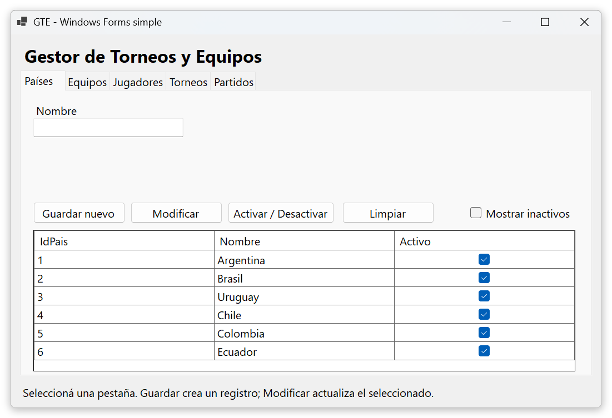

**CU-01 · Consultar países**
1. Abrir la pestaña **Países**. La grilla muestra los países activos.
2. Para ver también los desactivados, tildar **Mostrar inactivos**. La columna **Activo** indica el estado.

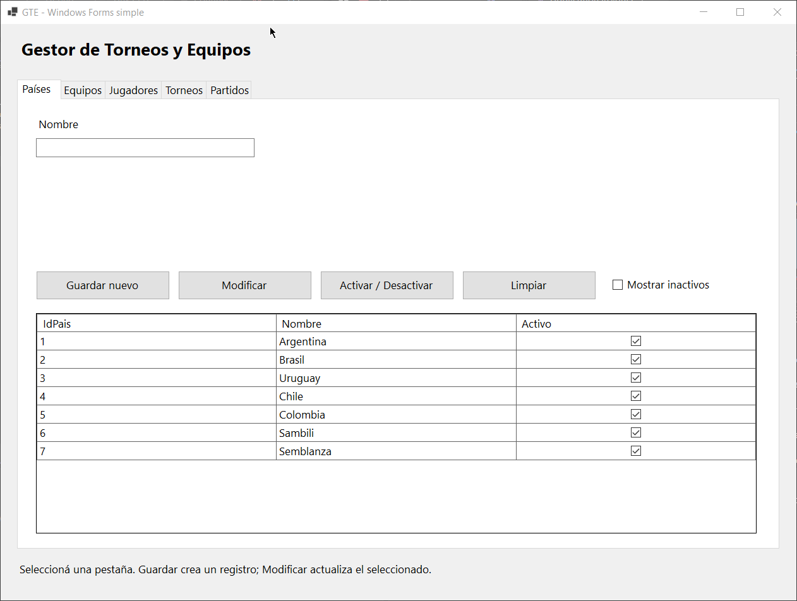

**CU-02 · Alta de país**
1. Escribir el **Nombre**.
2. Clic en **Guardar nuevo** → *"País guardado correctamente"*.

> ⚠️ El nombre es obligatorio (1 a 50 caracteres) y no puede repetirse, ni siquiera con un país inactivo: en ese caso, reactivarlo (CU-04).

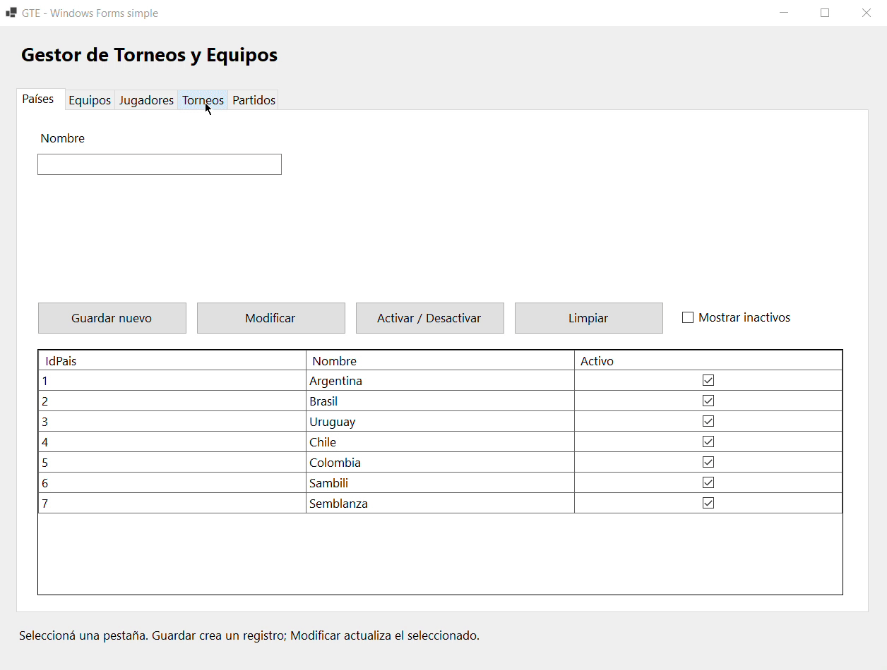

**CU-03 · Modificación de país**
1. Seleccionar el país en la grilla.
2. Cambiar el **Nombre** y hacer clic en **Modificar** → *"País modificado correctamente"*.

> ⚠️ Hay que seleccionar una fila. El nuevo nombre no puede coincidir con el de otro país.

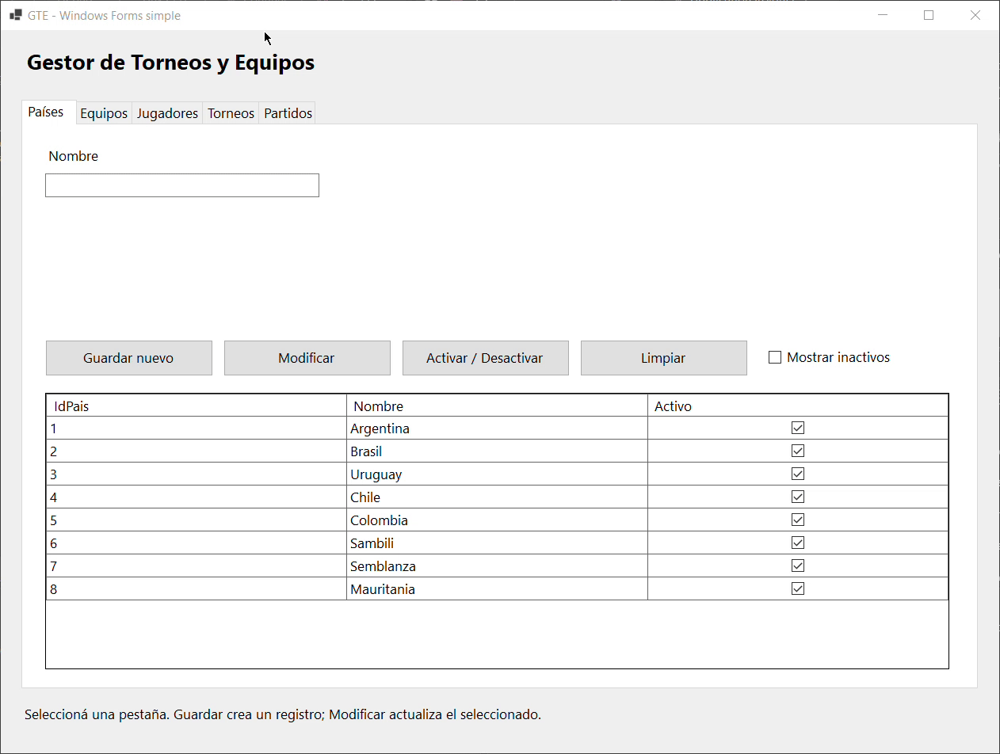

**CU-04 · Baja y reactivación de país**
1. Seleccionar el país (para reactivar, tildar antes **Mostrar inactivos**).
2. Clic en **Activar / Desactivar** → *"Estado actualizado correctamente"*.

> ⚠️ **No se puede desactivar un país que tenga jugadores activos.** Primero hay que desactivar o cambiar de país a esos jugadores.

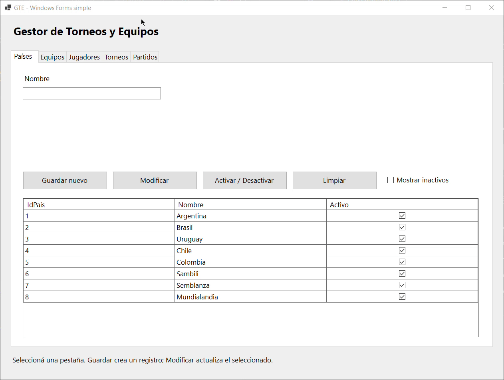

### 2.3 Equipos

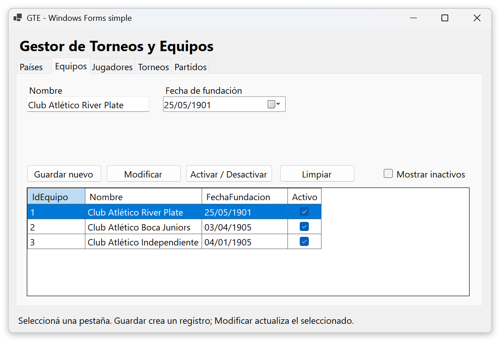

**CU-05 · Consultar equipos**
1. Abrir la pestaña **Equipos**. La fecha de fundación se muestra como día/mes/año.
2. Tildar **Mostrar inactivos** para ver también los desactivados.


**CU-06 · Alta de equipo**
1. Completar **Nombre** y **Fecha de fundación**.
2. Clic en **Guardar nuevo** → *"Equipo fundado correctamente"*.

> ⚠️ El nombre es obligatorio (1 a 50 caracteres) y no puede repetirse. La fecha de fundación no puede ser futura.

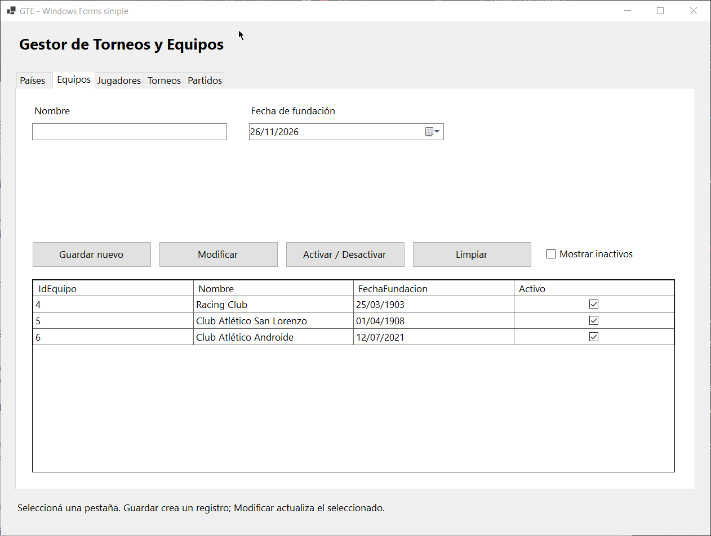

**CU-07 · Modificación de equipo**
1. Seleccionar el equipo, cambiar los datos y hacer clic en **Modificar** → *"Equipo modificado correctamente"*.

> ⚠️ Mismas reglas que el alta; el nombre no puede coincidir con el de otro equipo.


**CU-08 · Baja y reactivación de equipo**
1. Seleccionar el equipo (para reactivar, tildar antes **Mostrar inactivos**).
2. Clic en **Activar / Desactivar**.

> ⚠️ **No se puede desactivar un equipo que tenga jugadores activos ni partidos activos.** Primero hay que desactivar esos jugadores y partidos.

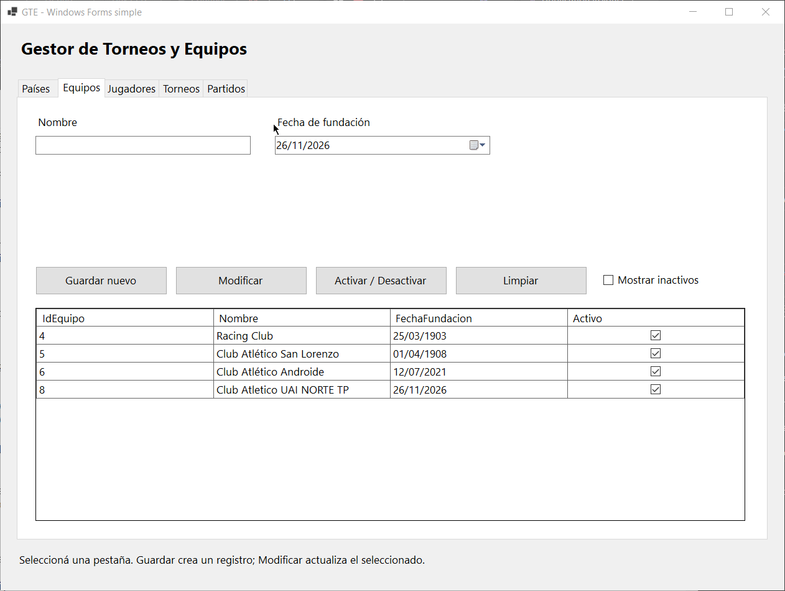

### 2.4 Jugadores

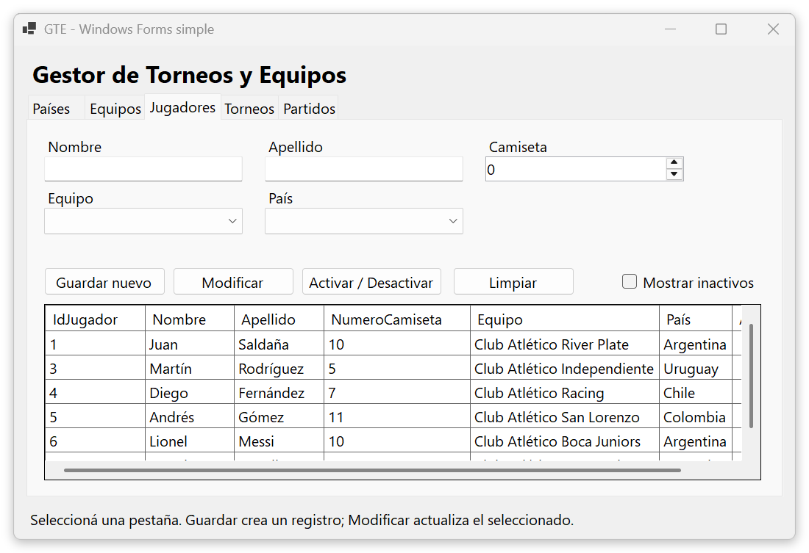

**CU-09 · Consultar jugadores**
1. Abrir la pestaña **Jugadores**. Las columnas **Equipo** y **País** muestran los nombres.
2. Tildar **Mostrar inactivos** para ver también los desactivados.

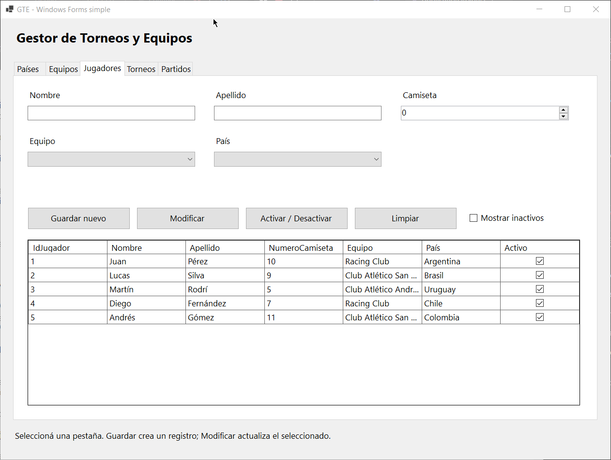

**CU-10 · Alta de jugador**
1. Completar **Nombre**, **Apellido** y **Camiseta**, y elegir **Equipo** y **País** de las listas.
2. Clic en **Guardar nuevo** → *"Jugador guardado correctamente"*.

> ⚠️ Nombre y apellido obligatorios (1 a 50 caracteres). Camiseta de 1 a 99. Equipo y país obligatorios y activos. **En un mismo equipo no puede haber dos jugadores activos con el mismo número de camiseta, ni con el mismo nombre y apellido.**

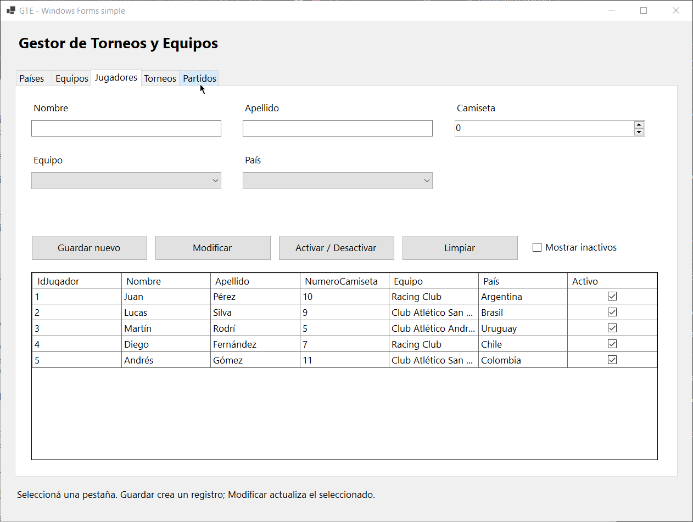

**CU-11 · Modificación de jugador**
1. Seleccionar el jugador, cambiar los datos y hacer clic en **Modificar** → *"Jugador modificado correctamente"*.

> ⚠️ Mismas reglas que el alta (el jugador no se compara consigo mismo).

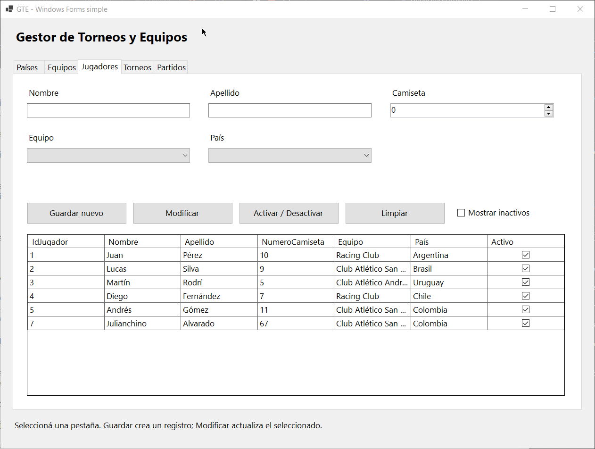

**CU-12 · Baja y reactivación de jugador**
1. Seleccionar el jugador (para reactivar, tildar antes **Mostrar inactivos**).
2. Clic en **Activar / Desactivar**.

> ⚠️ Desactivar no tiene restricciones. **Para reactivar, su equipo y su país tienen que estar activos y no puede quedar duplicado** (camiseta o nombre y apellido) con otro jugador activo del equipo.

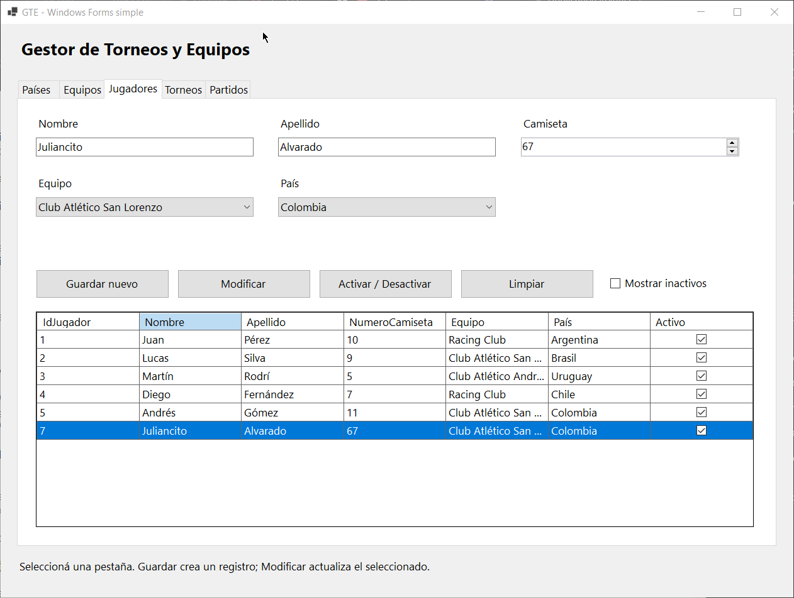

### 2.5 Torneos

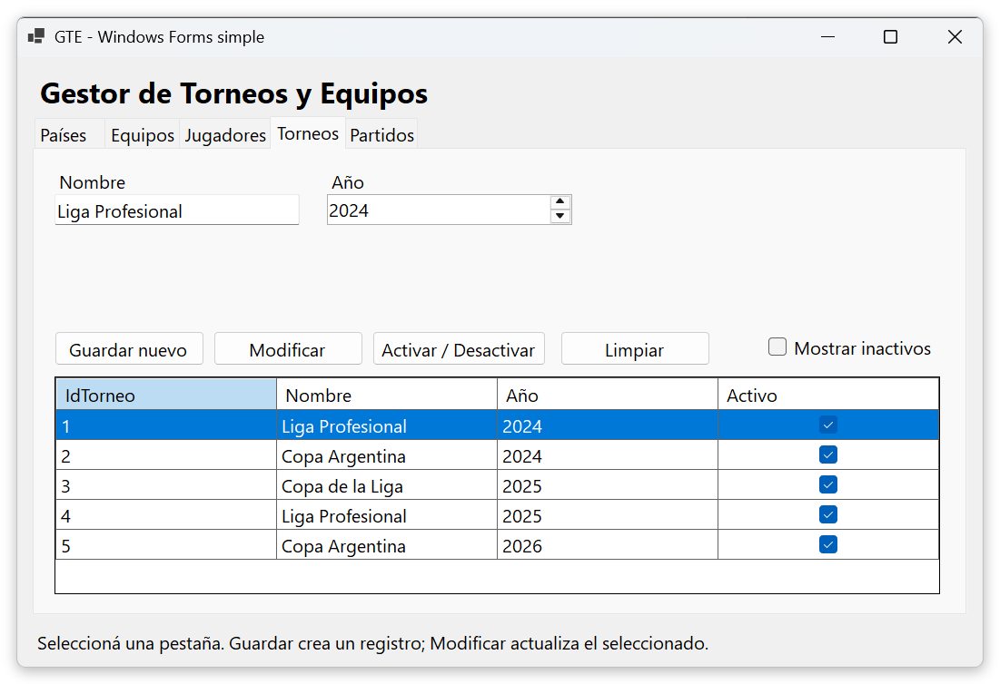

**CU-13 · Consultar torneos**
1. Abrir la pestaña **Torneos**. Tildar **Mostrar inactivos** para ver también los desactivados.

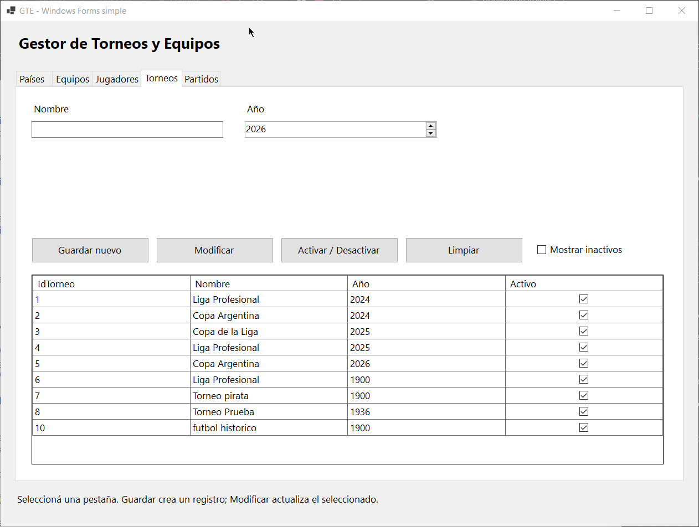

**CU-14 · Alta de torneo**
1. Completar **Nombre** y **Año**.
2. Clic en **Guardar nuevo** → *"Torneo guardado correctamente."*

> ⚠️ Nombre obligatorio (1 a 50 caracteres). Año de 1900 a 2100. No puede haber dos torneos con el mismo nombre en el mismo año (sí en años distintos).


**CU-15 · Modificación de torneo**
1. Seleccionar el torneo, cambiar los datos y hacer clic en **Modificar** → *"Torneo modificado correctamente."*

> ⚠️ **No se puede cambiar el año de un torneo que ya tiene partidos cargados.** El nombre sí puede cambiarse.


**CU-16 · Baja y reactivación de torneo**
1. Seleccionar el torneo (para reactivar, tildar antes **Mostrar inactivos**).
2. Clic en **Activar / Desactivar** → *"Estado del torneo actualizado correctamente."*

> ⚠️ **No se puede desactivar un torneo que tenga partidos activos.**

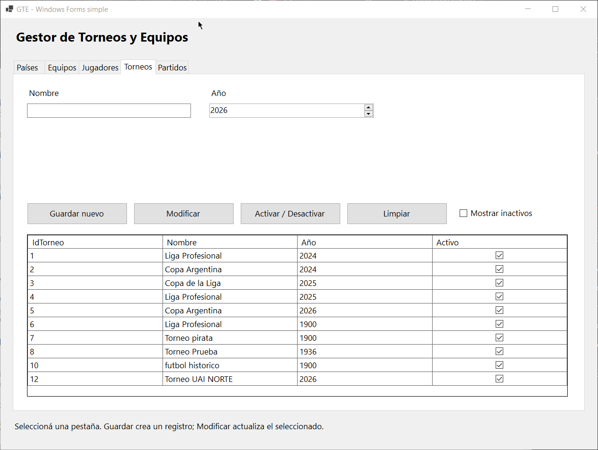

### 2.6 Partidos

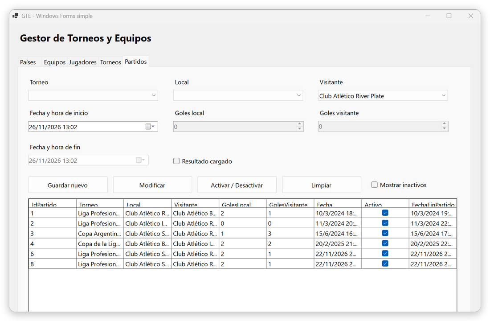

**CU-17 · Consultar partidos**
1. Abrir la pestaña **Partidos**. Las columnas **Torneo**, **Local** y **Visitante** muestran los nombres; el torneo aparece como "Nombre (Año)".
2. Los partidos sin resultado muestran **"-"** en los goles, para no confundirlos con un 0 a 0.
3. Tildar **Mostrar inactivos** para ver también los desactivados.


**CU-18 · Alta de partido**
1. Elegir **Torneo**, **Local** y **Visitante**, y completar **Fecha y hora de inicio**.
2. Dejar **Resultado cargado** sin tildar (si el partido todavía no se jugó).
3. Clic en **Guardar nuevo** → *"Partido guardado correctamente"*.

> ⚠️ Torneo y equipos obligatorios y activos. **Local y visitante distintos.** **La fecha debe estar dentro del año del torneo.** **Un equipo no puede tener dos partidos activos el mismo día**, ni como local ni como visitante.

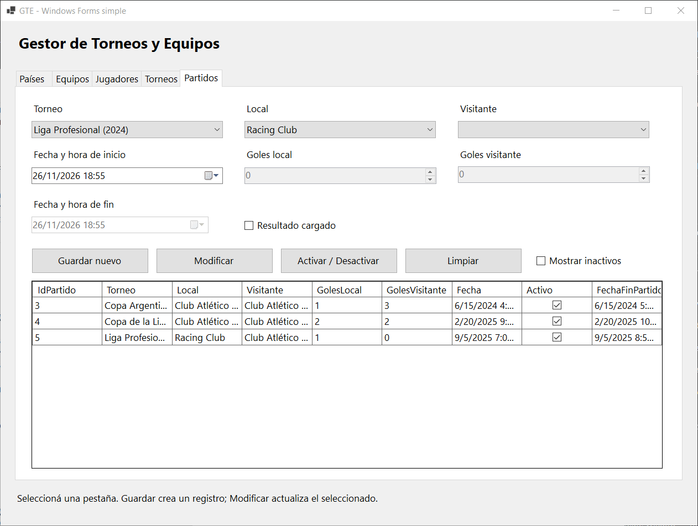

**CU-19 · Cargar el resultado de un partido**
1. Seleccionar el partido en la grilla.
2. Tildar **Resultado cargado**: se habilitan **Goles local**, **Goles visitante** y **Fecha y hora de fin**.
3. Completar los goles y la fecha de fin, y hacer clic en **Modificar**.

> ⚠️ Goles de 0 a 99. **La fecha de fin es obligatoria, debe ser posterior al inicio, no puede ser futura y debe caer en el año del torneo.** Si se destilda **Resultado cargado** y se modifica, se borran los goles y la fecha de fin.

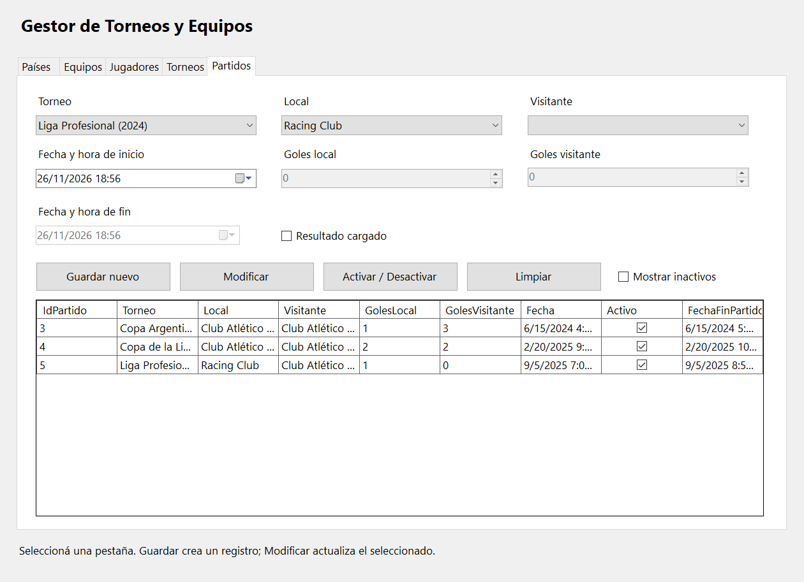

**CU-20 · Modificación de partido**
1. Seleccionar el partido, cambiar los datos y hacer clic en **Modificar** → *"Partido modificado correctamente"*.

> ⚠️ Mismas reglas que el alta (el partido no se compara consigo mismo).

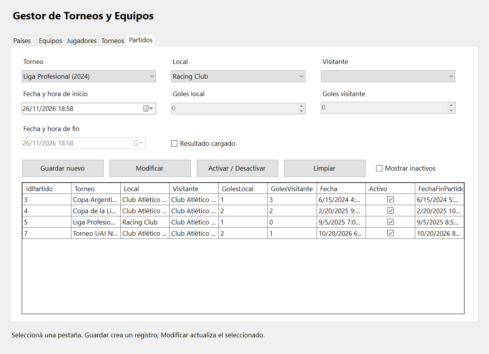

**CU-21 · Baja y reactivación de partido**
1. Seleccionar el partido (para reactivar, tildar antes **Mostrar inactivos**).
2. Clic en **Activar / Desactivar** → *"Estado del partido actualizado correctamente"*.

> ⚠️ Desactivar no tiene restricciones. **Para reactivar se vuelven a controlar sus reglas:** torneo y equipos activos, fecha dentro del año del torneo, fecha de fin válida y ningún equipo con otro partido activo ese día.

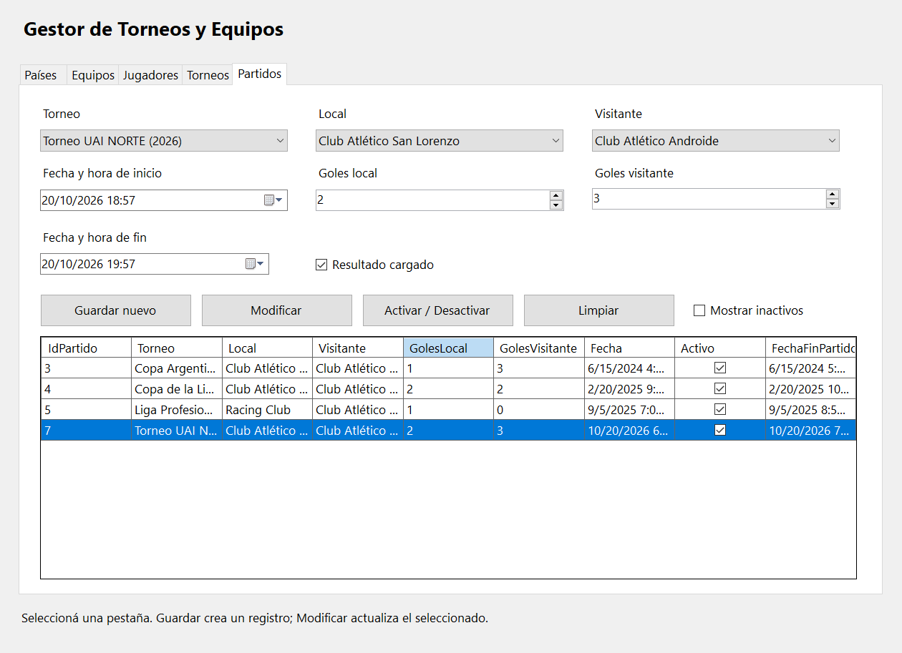

---

## 3. Restricciones y reglas de negocio

Todas las reglas se validan en la capa de negocio (BLL), dentro de una transacción. Si una falla, la operación se cancela completa y el usuario ve el mensaje correspondiente.

### 3.1 Reglas generales

- **RN-01.** Ningún registro se elimina físicamente: la baja es lógica (campo `ACTIVO`).
- **RN-02.** Los nombres y apellidos son obligatorios y tienen entre 1 y 50 caracteres. Se ignoran los espacios al principio y al final.
- **RN-03.** Para modificar o cambiar el estado, hay que seleccionar un registro existente de la grilla.
- **RN-04.** Las listas desplegables solo ofrecen registros activos.

### 3.2 Reglas por entidad

| Código | Entidad | Regla |
|---|---|---|
| RN-05 | País | No puede haber dos países con el mismo nombre (incluye inactivos) |
| RN-06 | País | No se puede desactivar un país con jugadores activos |
| RN-07 | Equipo | No puede haber dos equipos con el mismo nombre (incluye inactivos) |
| RN-08 | Equipo | La fecha de fundación no puede ser futura |
| RN-09 | Equipo | No se puede desactivar un equipo con jugadores activos o partidos activos |
| RN-10 | Torneo | El año va de 1900 a 2100 |
| RN-11 | Torneo | No puede haber dos torneos con el mismo nombre en el mismo año |
| RN-12 | Torneo | No se puede cambiar el año de un torneo con partidos cargados |
| RN-13 | Torneo | No se puede desactivar un torneo con partidos activos |
| RN-14 | Jugador | El número de camiseta va de 1 a 99 |
| RN-15 | Jugador | Debe pertenecer a un equipo y a un país activos |
| RN-16 | Jugador | En un mismo equipo no puede haber dos jugadores activos con el mismo número de camiseta |
| RN-17 | Jugador | En un mismo equipo no puede haber dos jugadores activos con el mismo nombre y apellido |
| RN-18 | Jugador | Al reactivarlo se controlan RN-15, RN-16 y RN-17 |
| RN-19 | Partido | El torneo y los dos equipos deben estar seleccionados y activos |
| RN-20 | Partido | El equipo local y el visitante deben ser distintos |
| RN-21 | Partido | La fecha de inicio debe estar dentro del año del torneo |
| RN-22 | Partido | Un equipo no puede tener dos partidos activos el mismo día |
| RN-23 | Partido | Con resultado cargado: goles de 0 a 99 |
| RN-24 | Partido | Con resultado cargado: fecha de fin obligatoria, posterior al inicio, no futura y dentro del año del torneo |
| RN-25 | Partido | Sin resultado cargado, los goles y la fecha de fin quedan en `NULL` |
| RN-26 | Partido | Al reactivarlo se controlan RN-19, RN-21, RN-22 y RN-24 |

### 3.3 Mensajes del sistema

| Mensaje | Causa | Solución |
|---|---|---|
| "No se pudo conectar a la base de datos." | SQL Server detenido, base inexistente o cadena de conexión incorrecta | Ver la [Guía de configuración](#1-guía-de-configuración) |
| "El nombre del ... debe tener entre uno y cincuenta caracteres." | Nombre vacío o demasiado largo | Completar un nombre de hasta 50 caracteres |
| "Ya existe un ... con ese nombre." | Nombre repetido | Usar otro nombre o reactivar el existente |
| "Ya existe un torneo con ese nombre y año." | Torneo repetido | Cambiar el nombre o el año |
| "Debe seleccionar un ... de la grilla." | Modificar o desactivar sin elegir una fila | Hacer clic en una fila antes de la acción |
| "Debe seleccionar un equipo." / "un pais." / "un torneo." | Lista desplegable vacía | Elegir una opción |
| "El ... seleccionado esta inactivo." | Se eligió un registro desactivado | Reactivarlo o elegir otro |
| "La fecha de fundacion no puede ser futura." | Fecha posterior a hoy | Corregir la fecha |
| "El año del torneo debe estar entre 1900 y 2100." | Año fuera de rango | Corregir el año |
| "No se puede cambiar el año del torneo porque tiene partidos cargados." | RN-12 | Crear un torneo nuevo para el otro año |
| "El numero de camiseta debe estar entre 1 y 99." | Camiseta fuera de rango | Elegir un número de 1 a 99 |
| "Ya existe un jugador activo en ese equipo con ese numero de camiseta." | RN-16 | Elegir otro número |
| "Ya existe un jugador activo con el mismo nombre y apellido en ese equipo." | RN-17 | Revisar si el jugador ya estaba cargado |
| "No se puede desactivar el ... porque tiene jugadores (o partidos) activos." | RN-06, RN-09, RN-13 | Desactivar antes los registros que dependen |
| "El equipo local y el visitante deben ser distintos." | RN-20 | Elegir equipos distintos |
| "La fecha del partido debe estar dentro del año del torneo (...)." | RN-21 / RN-24 | Corregir la fecha o elegir el torneo correcto |
| "El equipo local (o visitante) ya tiene un partido en esa fecha." | RN-22 | Elegir otra fecha u otro equipo |
| "Los goles deben estar entre 0 y 99." | RN-23 | Corregir los goles |
| "Debe seleccionar la fecha de finalización del partido." | RN-24 | Completar la fecha de fin |
| "La fecha de finalización debe ser posterior a la fecha de inicio." | RN-24 | Corregir la fecha de fin |
| "No se puede cargar el resultado de un partido que todavía no terminó." | RN-24 | Cargar el resultado cuando el partido termine |

---

## 4. Descripción técnica

### 4.1 Tecnologías

| Componente | Tecnología |
|---|---|
| Lenguaje | C# |
| Plataforma | .NET 10 |
| Interfaz | Windows Forms |
| Acceso a datos | Entity Framework Core 10 |
| Base de datos | Microsoft SQL Server |
| Entorno de desarrollo | Visual Studio 2026 |
| Control de versiones | Git y GitHub (ramas, Pull Requests y revisión de código) |

### 4.2 Arquitectura en capas

La solución tiene cinco proyectos, uno por capa. Cada capa solo llama a la que está inmediatamente debajo.

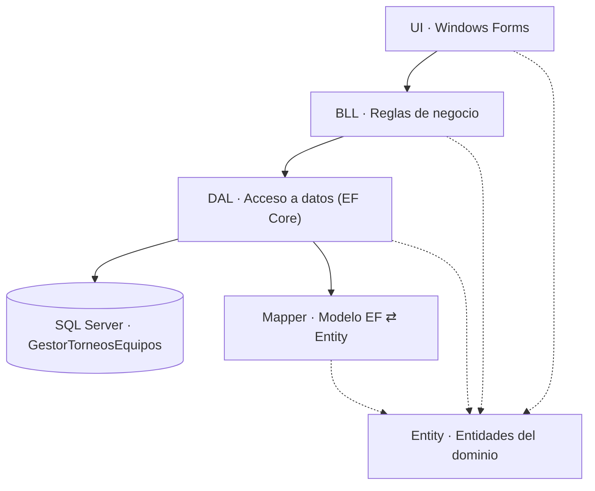

| Proyecto | Responsabilidad |
|---|---|
| **UI** | Formulario con una pestaña por entidad. Muestra datos y captura acciones. No tiene reglas de negocio |
| **BLL** | Valida las reglas de negocio y coordina cada operación dentro de una transacción |
| **DAL** | Lee y escribe en SQL Server mediante Entity Framework Core |
| **Mapper** | Convierte entre las clases del modelo EF y las entidades |
| **Entity** | Entidades del dominio (`PaisEntity`, `EquipoEntity`, etc.) y modelo de EF. Compartida por todas las capas |

### 4.3 Transacciones de negocio

Cada alta, modificación y cambio de estado se ejecuta dentro de un `TransactionScope` en la BLL. Las validaciones y la escritura forman una única unidad: solo si todo termina bien se llama a `Complete()` y se confirman los cambios. Si ocurre un error, la base queda como estaba.

### 4.4 Estructura del repositorio

```
TP-2026-GRUPO1-ADS/
├── Database/
│   └── GestorTorneosEquiposDB.sql      Script de creación y datos de prueba
└── TrabajoPracticoGrupoUno/
    ├── TrabajoPracticoFutbol.slnx      Solución
    ├── UI/                             Form1 + App.config
    ├── BLL/                            XxxBusiness
    ├── DAL/                            XxxDAL + ModeloParcialContext
    ├── Mapper/                         XxxMapper
    └── Entity/                         XxxEntity + EFModel/
```

---

## 5. Modelo de datos

La base `GestorTorneosEquipos` tiene cinco tablas. País, Equipo y Torneo son independientes; Jugador y Partido las referencian con claves foráneas.

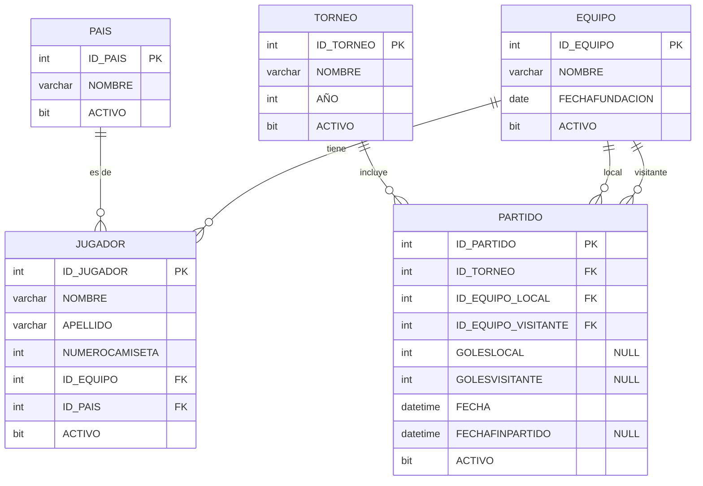

- Todas las claves primarias son `int IDENTITY`.
- Todos los `varchar` son de 50 caracteres.
- En **Partido**, `GOLESLOCAL`, `GOLESVISITANTE` y `FECHAFINPARTIDO` admiten `NULL`: quedan vacíos mientras el partido no tiene resultado.

---

## 6. Diagrama de clases

Cada entidad repite el mismo patrón: una clase de negocio, una de acceso a datos, un mapper y una entidad. En los nombres, `Xxx` representa a Pais, Equipo, Jugador, Torneo o Partido.

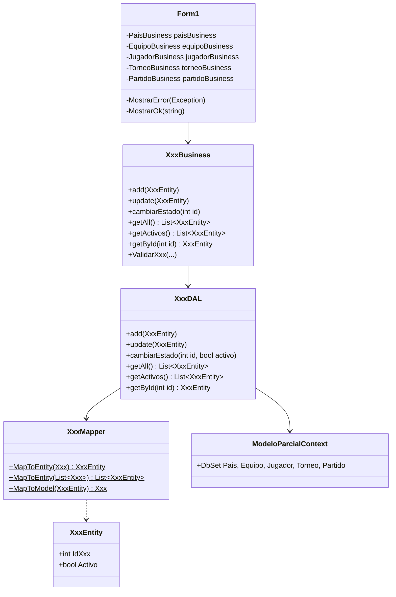

Particularidades: `PaisBusiness` y `PaisDAL` tienen además `ProbarConexion()`, que se usa al abrir el programa; `PartidoBusiness` y `PartidoDAL` reciben un parámetro `resultadoCargado` en `add` y `update`; `TorneoDAL` tiene `getByNombreYAnio` y `PaisDAL`/`EquipoDAL` tienen `getByNombre`.

